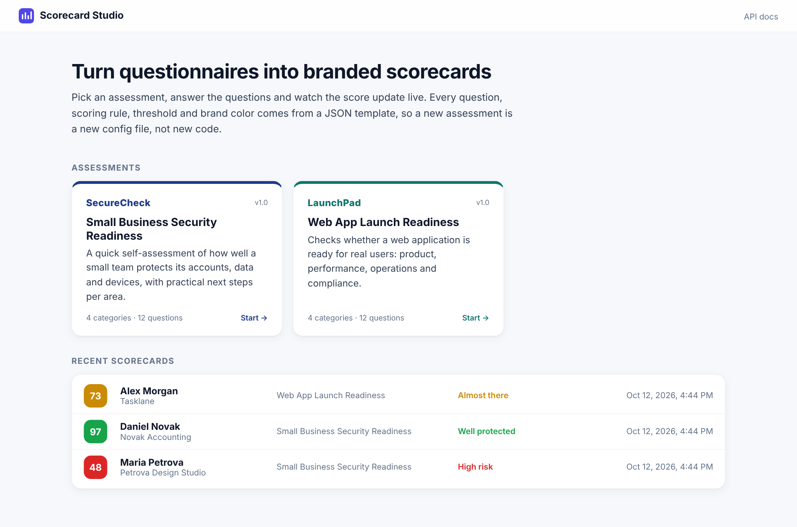
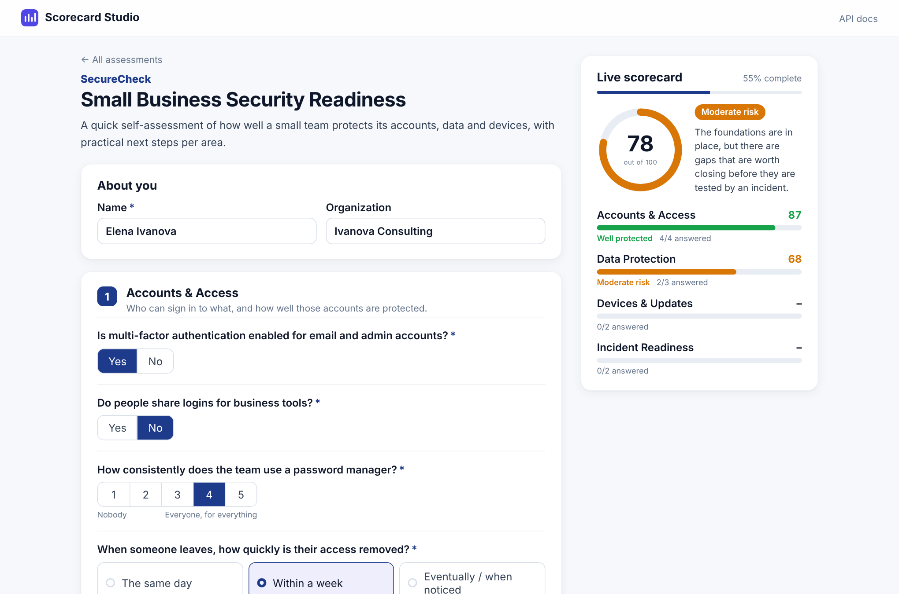
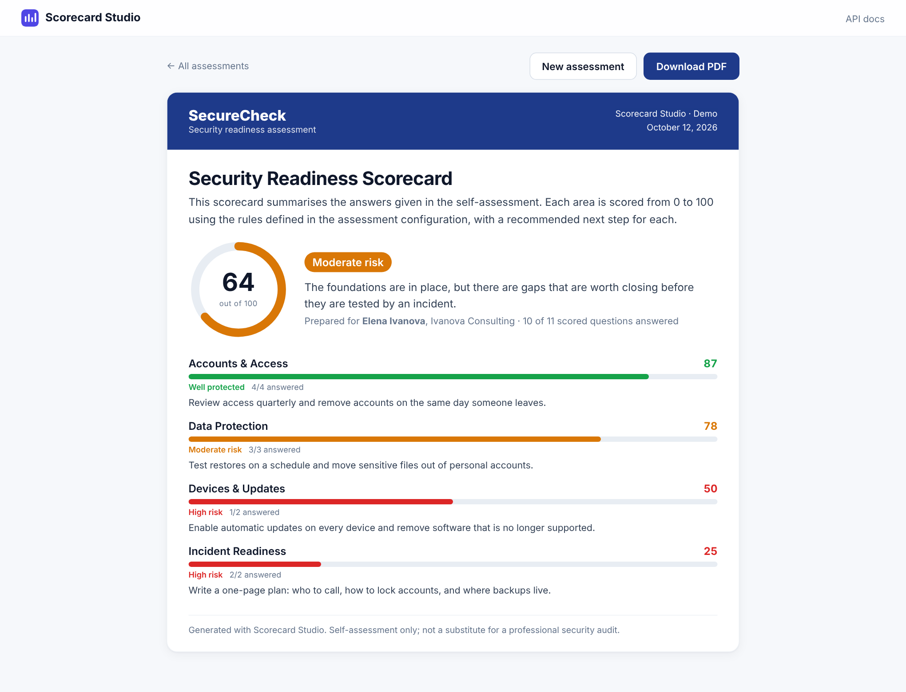
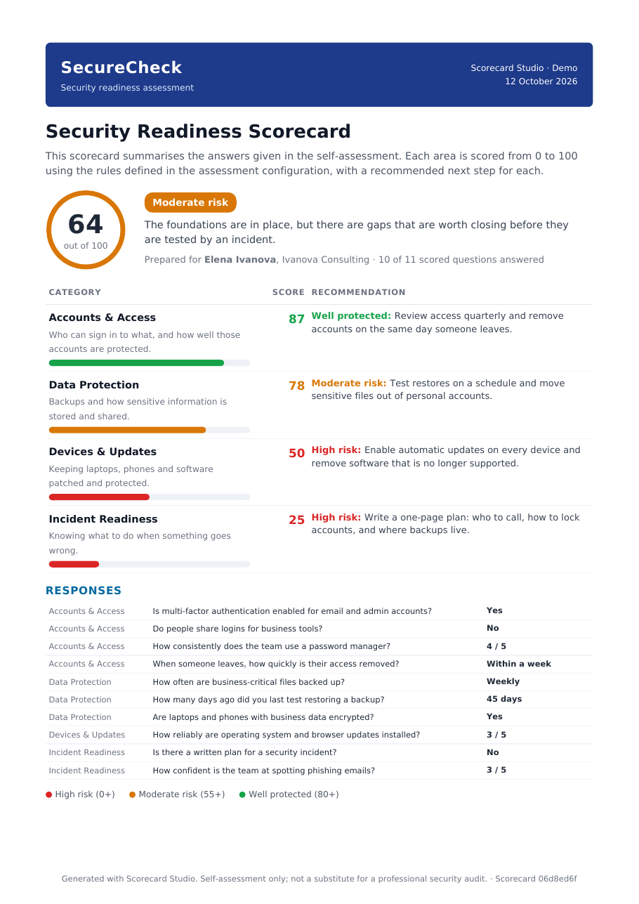
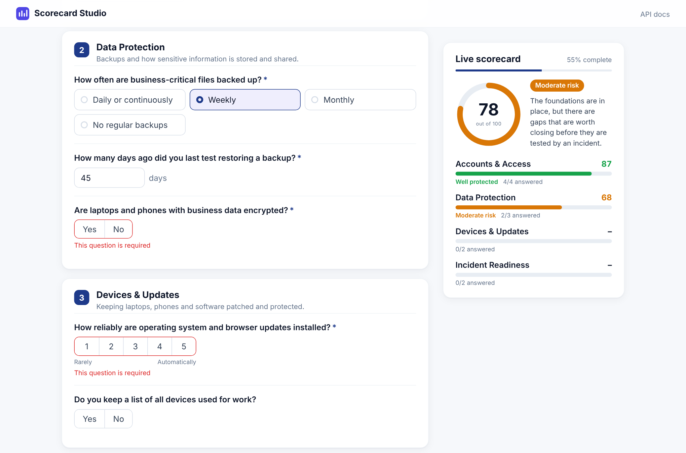

# Scorecard Studio

A config-driven web app that turns questionnaire answers into branded one-page scorecards and downloadable PDF reports.

Users fill in a structured form, the backend validates every answer, scores each category from rules declared in a JSON template, shows a live status while the form is being filled in, and produces a polished final report. Questions, scoring rules, thresholds, recommendations, branding and report copy all live in configuration, so the same engine runs completely different assessments without code changes.



| Live preview while filling in | Final scorecard |
|---|---|
|  |  |

| Generated PDF | Server-side validation |
|---|---|
|  |  |

A sample PDF is in [`docs/sample-scorecard.pdf`](docs/sample-scorecard.pdf).

## Features

- **Config-driven assessments.** Each assessment is one JSON file: categories, questions, weights, scoring rules, status thresholds, per-status recommendations, colors and report text. Two complete examples ship with the app (a small-business security readiness check and a web app launch readiness check).
- **Five question types.** 1–N scales, yes/no (optionally inverted), single choice with per-option scores, numeric input scored through ranges (e.g. "days since last backup test"), and unscored free text.
- **Rule-based scoring.** Weighted questions roll up into weighted categories and an overall 0–100 score, mapped to a status band such as *High risk / Moderate risk / Well protected*.
- **Live preview.** While the form is filled in, the backend scores partial answers and the sidebar updates the score ring, status and category bars (debounced, stale requests are cancelled).
- **Server-side validation.** Required answers, ranges, allowed options, types and text length are checked by the API and returned as field-level errors (RFC 7807 problem responses).
- **Branded PDF output.** One-page A4 report rendered from an HTML template with OpenHTMLtoPDF, using the template's colors and copy, with full Unicode support (e.g. Cyrillic names).
- **Reproducible reports.** Each stored scorecard keeps a snapshot of the template it was scored with, so old reports regenerate exactly even after the config changes.
- **History.** Recent scorecards are listed on the home page; demo data is seeded on first start.
- **OpenAPI docs** at `/api/docs`.

## Tech stack

| Layer | Technology |
|---|---|
| Backend | Java 21, Spring Boot 3.3 (Web, Validation, Data JPA, Thymeleaf), Flyway |
| PDF | OpenHTMLtoPDF (PDFBox) + Thymeleaf HTML template |
| Database | PostgreSQL 16 (answers, results and template snapshots as JSONB) |
| Frontend | Vue 3 (Composition API), Vue Router, Vite |
| Delivery | Docker multi-stage builds, Nginx, Docker Compose |
| Tests | JUnit 5, AssertJ (scoring engine, config validation, PDF rendering) |

## Run it

Requirements: Docker with Compose.

```bash
docker compose up --build
```

Open http://localhost:8081. API docs: http://localhost:8081/api/docs.

### Local development

```bash
# database
docker compose up -d db   # or a local PostgreSQL with db/user/password "scorecard"

# backend (http://localhost:8080)
cd backend && mvn spring-boot:run

# frontend (http://localhost:5173, proxies /api to the backend)
cd frontend && npm install && npm run dev
```

Run the tests with `cd backend && mvn test`.

## Adding an assessment

Put a JSON file in `config/scorecards/` and restart the backend (`docker compose restart backend`). A file with the same `id` as a built-in template replaces it. Full examples: [`backend/src/main/resources/scorecards/`](backend/src/main/resources/scorecards/).

```json
{
  "id": "vendor-review",
  "version": "1.0",
  "name": "Vendor Review",
  "branding": { "organization": "Acme", "tagline": "Supplier check", "logoText": "Acme",
                "primaryColor": "#7c3aed", "accentColor": "#0f766e" },
  "thresholds": [
    { "id": "low", "label": "Do not proceed", "min": 0, "color": "#dc2626", "summary": "..." },
    { "id": "ok", "label": "Approved", "min": 70, "color": "#16a34a", "summary": "..." }
  ],
  "categories": [{
    "id": "delivery", "name": "Delivery", "weight": 2,
    "recommendations": { "low": "Ask for a delivery plan.", "ok": "Keep monitoring." },
    "questions": [
      { "id": "on-time", "label": "Share of orders delivered on time", "type": "NUMBER", "unit": "%",
        "min": 0, "max": 100, "required": true,
        "bands": [ { "to": 80, "score": 20 }, { "from": 80, "to": 95, "score": 70 }, { "from": 95, "score": 100 } ] },
      { "id": "support", "label": "Support quality", "type": "SCALE", "min": 1, "max": 5, "required": true }
    ]
  }],
  "report": { "title": "Vendor Scorecard", "intro": "...", "footer": "..." }
}
```

Templates are validated at startup (unique ids, valid ranges and options, thresholds starting at 0, recommendation keys that match thresholds, strict hex colors). A broken template stops the app with a list of every problem instead of producing wrong scores later.

### Scoring rules

| Type | Answer | Score (0–100) |
|---|---|---|
| `SCALE` | whole number `min`…`max` | linear position in the range; `invert` flips it |
| `YES_NO` | `true` / `false` | yes = 100, no = 0; `invert` flips it |
| `CHOICE` | an option `value` | that option's `score` |
| `NUMBER` | any number within optional `min`/`max` | `score` of the first band where `from ≤ value < to` |
| `TEXT` | up to 2000 characters | not scored, shown in the report |

Category score = weighted average of its answered questions. Overall score = weighted average of the categories. The status is the highest threshold whose `min` the score reaches.

## Architecture

```
frontend (Vue 3, Nginx) ──/api──> backend (Spring Boot) ──> PostgreSQL
                                      │
             config/scorecards/*.json ┘  (templates, loaded and validated at startup)
```

Backend packages:

- `template` – template model, loader (`TemplateRegistry`) and config validation
- `scoring` – `ScoringEngine`: answer validation and score calculation, independent of web and database
- `submission` – JPA entity, repository and service for stored scorecards
- `pdf` – HTML-to-PDF report rendering
- `web` – REST controllers, DTOs and error mapping

## API

| Method | Path | Purpose |
|---|---|---|
| GET | `/api/templates` | List assessments |
| GET | `/api/templates/{id}` | Full template definition |
| POST | `/api/templates/{id}/evaluate` | Score partial answers (live preview, nothing saved) |
| POST | `/api/templates/{id}/submissions` | Validate, score and store a completed questionnaire |
| GET | `/api/submissions` | Recent scorecards (`?templateId=&limit=`) |
| GET | `/api/submissions/{id}` | Stored scorecard with answers and result |
| GET | `/api/submissions/{id}/pdf` | Download the PDF report |

## Security notes

- **No code in config.** Scoring rules are data (ranges, option scores, bands, weights); there is no expression language or scripting, so a template cannot execute code.
- **No injection into the PDF.** All user input reaches the report through escaped Thymeleaf expressions; colors that go into the stylesheet must match a strict `#rrggbb` pattern; the PDF renderer is not allowed to resolve any URL or file, so report content cannot make the server fetch resources.
- **Strict input validation.** Unknown question ids, wrong types, out-of-range values and oversized text are rejected server-side; request sizes are capped.
- **Safe error responses.** Errors are returned as RFC 7807 problem details without stack traces or internal messages.
- **Hardened delivery.** Backend container runs as a non-root user; Nginx sends a Content Security Policy, `X-Frame-Options: DENY`, `nosniff` and a strict referrer policy.

This is a demo project. It has no user accounts: anyone who can open the app can fill in assessments and view stored scorecards. A production deployment would add authentication and per-user access to submissions.

## License

MIT. Report font: DejaVu Sans (see `backend/src/main/resources/fonts/DejaVu-LICENSE.txt`).
